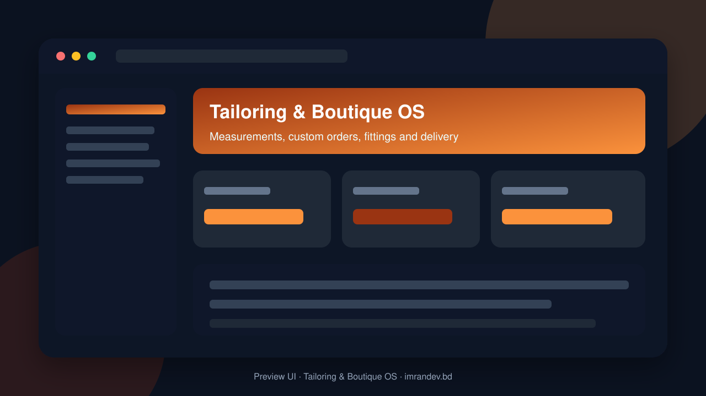
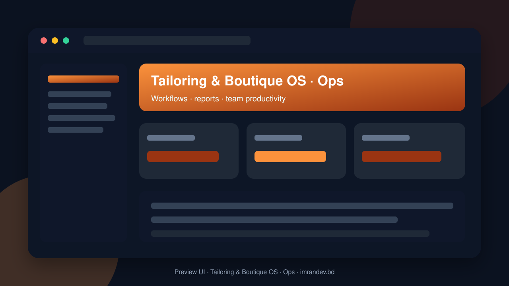

<p align="center">
  
</p>

<h1 align="center">Tailoring & Boutique OS</h1>

<p align="center"><strong>Measurements, custom orders, fittings and delivery</strong></p>

<p align="center">
  <a href="https://github.com/imranbru99/tailoring-boutique-management-orders"></a>
  
  
</p>

---

## Overview

**Tailoring & Boutique OS** is a complete business application focused on real operational workflows. This README lists the full feature surface so GitHub visitors and search engines can understand every capability of the product.

## Product preview

| Dashboard | Operations |
| :---: | :---: |
|  |  |

## Complete feature list

### Product modules & capabilities

- Tailoring and Boutique Management System
- AI Integration Engineer
- Security Engineer
- QA Automation Engineer
- DevOps Engineer
- Redis where available
- Attendance Hardware
- Laravel Attendance Hub
- Orders
- Inventory
- Suppliers
- Invoices
- Reports
- Payments
- Delivery
- Module management dashboard
- Routes
- Total orders
- Pending orders
- Orders in production
- Orders awaiting fitting
- Ready for delivery
- Overdue orders
- Outstanding payments
- Inventory value
- Order status charts
- Payment statistics
- Customer photo
- Gender
- Date of birth
- Order history
- Payment history
- Printable measurement sheets
- Supplier
- Reorder level
- Boutique orders
- Bridal orders
- Uniform orders
- Corporate orders
- Bulk garment orders
- Embroidery orders
- Special design orders
- Order number
- Order date
- Expected delivery date
- Order type
- Advance payment
- Order workflow
- Work orders
- Branch manager
- Delivery staff
- Assigned orders
- Appointment booking
- Defect recording
- Ready-for-delivery queue
- Shop delivery
- Home delivery
- Courier delivery
- Delivery scheduling
- Delivery address

### Admin / Filament resources

- Alteration
- Appointment
- Coupon
- Customer
- Delivery
- Design Catalog
- Employee Attendance
- Employee
- Expense
- Fabric Type
- Garment Type
- Inventory Item
- Invoice
- Job Card
- Marketing Campaign
- Measurement Profile
- Measurement Template
- My Measurement
- My Order
- Order
- Payment
- Quality Inspection
- Subscription Plan
- Supplier
- Tenant

### Domain models

- Alteration
- Appointment
- Audit Log
- Boutique Product
- Branch
- Coupon
- Customer
- Customer Address
- Customer Membership
- Delivery
- Design Catalog
- Employee Attendance
- Expense
- Expense Category
- Fabric Roll
- Fabric Type
- Fitting
- Garment Type
- Inventory Item
- Invoice
- Invoice Item
- Job Card
- Leave Request
- Marketing Campaign
- Measurement Profile
- Measurement Template
- Measurement Version
- Membership Plan
- Order
- Order Item
- Order Status History
- Payment
- Pos Session
- Product Category
- Production Task
- Purchase Order
- Purchase Order Item
- Quality Inspection
- Shift
- Stock Movement
- Stock Reservation
- Subscription
- Subscription Plan
- Supplier
- Tenant
- Tenant Module
- Tenant Setting

### HTTP / API controllers

- Attendance APIs & screens
- Auth APIs & screens
- Customer APIs & screens
- Document APIs & screens
- Inventory APIs & screens
- Job Card APIs & screens
- Measurement APIs & screens
- Onboarding Wizard APIs & screens
- Order APIs & screens
- Public Website APIs & screens

### Detailed feature requirements delivered

- Application Name: Tailoring and Boutique Management
- CORE TECHNOLOGY STACK
- REQUIRED PACKAGES
- PRODUCT ARCHITECTURE
- DYNAMIC MODULE MANAGEMENT SYSTEM
- COMPLETE BUSINESS MODULES
- MODULE 1: Dashboard and Business Overview
- MODULE 2: Customer Relationship Management
- MODULE 3: Body Measurement Management
- MODULE 4: Garment and Design Catalog
- MODULE 5: Fabric and Material Management
- MODULE 6: Tailoring Order Management
- MODULE 7: Production Management
- MODULE 8: Tailor and Employee Management
- MODULE 9: Appointment and Fitting Management
- MODULE 10: Quality Control
- MODULE 11: Fitting and Alteration
- MODULE 12: Delivery and Dispatch
- MODULE 13: POS and Sales Management
- MODULE 14: Inventory and Stock Management
- MODULE 15: Supplier and Purchasing Management
- MODULE 16: Billing, Invoices and Payments
- MODULE 17: Accounting and Expense Management
- MODULE 18: Membership and Loyalty
- MODULE 19: Marketing and CRM Automation
- MODULE 20: Staff Attendance and HR
- MODULE 21: Reports and Analytics
- MODULE 22: Customer Portal
- MODULE 23: Staff Portal
- MODULE 24: Business Settings
- MODULE 25: Multi-Branch Management
- MODULE 26: AI Business Assistant
- MODULE 27: SaaS Subscription Management
- MODULE 28: API and External Integrations
- MODULE 29: Data Import and Export
- MODULE 30: Audit and Security Management
- USER TYPES AND ROLE MANAGEMENT
- Supplier (optional external portal user)
- PUBLIC WEBSITE AND MARKETING PAGES
- PROFESSIONAL UI/UX DESIGN
- DATABASE ARCHITECTURE
- IMPORTANT BUSINESS LOGIC
- DEMO ENVIRONMENT
- Business Name: Elegant Stitch Boutique
- MULTILINGUAL SUPPORT
- NOTIFICATION SYSTEM
- SECURITY REQUIREMENTS
- PERFORMANCE AND SCALABILITY
- ADMINISTRATOR CONTROL CENTER
- PUBLIC DEMO AND ONBOARDING
- OPTIONAL ADVANCED FEATURES
- API DEVELOPMENT
- TESTING AND QUALITY ASSURANCE
- PROJECT STRUCTURE
- README.MD — COMPLETE PRODUCT DOCUMENTATION
- INSTALLATION AND DEPLOYMENT
- DEVELOPMENT EXECUTION PLAN
- Phase 1: Repository inspection and architecture
- Phase 2: Core foundation
- Phase 3: Main business functionality
- Phase 4: Commercial operations
- Phase 5: User portals
- Phase 6: Advanced functionality
- Phase 7: Public website
- Phase 8: Demo and testing
- Phase 9: Documentation and deployment
- STRICT DEVELOPMENT RULES
- FINAL ACCEPTANCE CRITERIA
- FINAL DELIVERY REQUIREMENTS

### Platform capabilities

- Multi-role ready structure for operators, managers and admins
- Database migrations and seeders for demo-ready local setup
- Laravel architecture with services/controllers/models separation
- Responsive UI foundation (Blade / Filament where enabled)
- Environment-based config for local and production databases
- GitHub-ready documentation with visual product previews

## Tech stack

- PHP 8.2+ / Laravel
- Filament admin resources (where enabled)
- Vite asset pipeline
- SQLite/MySQL-ready database layer
- Migrations, seeders, and test-ready structure

## Quick start

```bash
git clone https://github.com/imranbru99/tailoring-boutique-management-orders.git
cd tailoring-boutique-management-orders
composer install
cp .env.example .env
php artisan key:generate
php artisan migrate --seed
npm install && npm run build
php artisan serve
```

## Repository

- GitHub: https://github.com/imranbru99/tailoring-boutique-management-orders
- Developer: **Imran Ahmed** · https://imrandev.bd

---

## 🤝 Let's Connect & Collaborate

I am open to **Senior Remote Full-Stack Roles**, AI Platform Architecture Contracts, and Enterprise Technical Advisory.

**Timezone:** UTC+6 (Dhaka / Rangpur, Bangladesh) — flexible overlap with US, UK & EU hours.  
**Delivery:** Async-ready · Slack · Discord · Jira · GitHub · production-first accountability.

| Channel | Handle | Link |
| :--- | :--- | :--- |
| Portfolio | imrandev.bd | https://imrandev.bd |
| Packagist | imrandevbd | https://packagist.org/packages/imrandevbd/ |
| LinkedIn | imranbru99 | https://linkedin.com/in/imranbru99 |
| GitHub | imranbru99 | https://github.com/imranbru99 |
| WhatsApp | +880 1576-918420 | https://wa.me/8801576918420 |
| Email | me@imrandev.bd | mailto:me@imrandev.bd |
| X | @imrandev_bd | https://x.com/imrandev_bd |
| YouTube | @ImranDevBD | https://youtube.com/@ImranDevBD |
