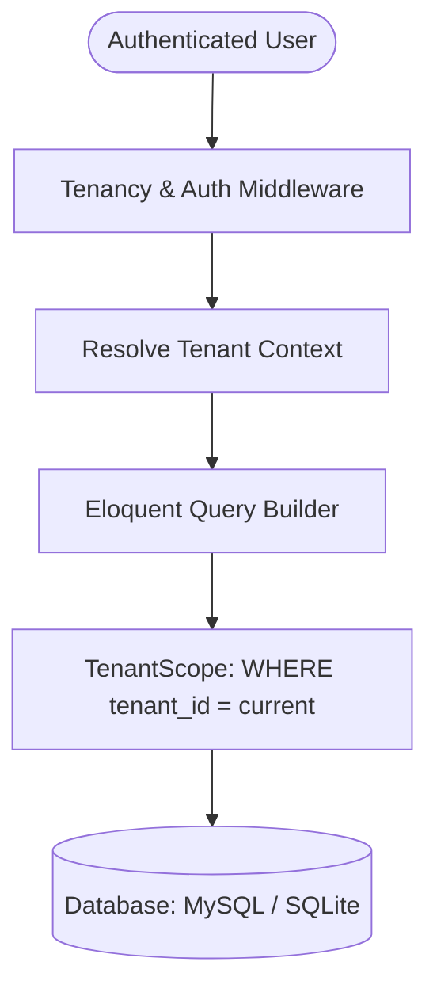
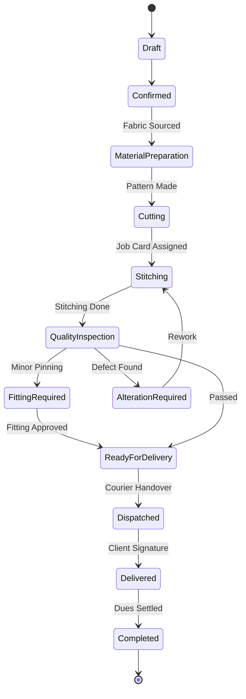

# System Architecture & Technical Specifications
### Tailoring and Boutique Management SaaS Operating System

Architect: **Imran Ahmed** ([https://imrandev.bd](https://imrandev.bd) | *me@imrandev.bd*)

---

## 1. Tenancy Model & Database Scoping

### Logical Data Isolation
Data isolation is guaranteed through an active global query scope rather than complex manual joins:
- **`App\Core\Tenancy\TenantScope`**: Automatically applied via the `BelongsToTenant` trait to every tenant-owned model (`Customer`, `Order`, `OrderItem`, `JobCard`, `InventoryItem`, `Invoice`, etc.).
- **Automatic Hydration**: On model creation, the `creating` Eloquent event auto-assigns the active `tenant_id` if not explicitly specified.
- **Bypass Safeguards**: The scope automatically bypasses when running from command line (CLI) or when an authenticated user is assigned the `super_admin` global platform role.

---

## 2. Dynamic Module Engine Architecture

The system treats business capabilities as decoupled, swappable components:
- **`App\Core\Modules\ModuleRegistry`**: Declarative registry defining unique keys, names, descriptions, categories, dependency arrays, and core statuses for 30 business modules.
- **`App\Core\Modules\ModuleManager`**: High-performance service handling activation, deactivation, dependency checks, cache eviction, and core module immutability guards.
- **`App\Http\Middleware\EnsureModuleActive`**: Route-level gate checking `isEnabled($moduleKey)` before granting access to controllers or Filament resources.
- **`App\Filament\App\Concerns\HasModuleGate`**: Trait utilized across Filament resources to dynamically conceal navigation items, action buttons, and resource pages when a tenant deactivates the corresponding module.

---

## 3. Order Workflow State Machine

The order lifecycle conforms to an audited 18-stage state machine defined in `App\Services\OrderWorkflowService`:

### Automatic Actions on Transitions
- **`draft` ➔ `confirmed`**:
  1. Deep clones active customer measurement profile values into `order_items.measurement_snapshot`.
  2. Spawns 3 discrete production `JobCard` records: Cutting, Stitching, and Finishing.
  3. Reserves fabric roll yardage in `stock_reservations`.
- **`ready_for_delivery` ➔ `delivered`**:
  1. Validates that no open quality control defects exist.
  2. Updates invoice payment balances.
  3. Records delivery timestamp and recipient signature status.

---

## 4. Hardware & Ecosystem Package Integration

### Biometric Attendance Bridge (`imrandevbd/laravel-attendance-hub`)
Biometric punch terminals interface via HTTP ADMS / IClock protocols. Terminal punches trigger:
1. Lookup or creation of `EmployeeAttendance` for the current date.
2. Grace-period comparison against the active `Shift`.
3. Auto-flagging of `late` arrivals when exceeding threshold minutes.
4. Overtime calculation when shift hours exceed standard labor limits.

### AI Hub & AI Catalog (`imrandevbd/laravel-ai-hub` & `laravel-ai-catalog`)
- Providers are configured with automated failovers (Google Gemini -> OpenAI GPT-4o -> Claude 3.5 Sonnet).
- All AI-generated product descriptions and fabric specifications are saved with `status = draft` in `ai_catalog_generations` for human review prior to showroom publishing.

### Unicode PDF Engine (`imrandevbd/laravel-unicode-pdf`)
- Renders server-side Unicode documents without external binaries.
- Auto-detects text direction (LTR vs RTL) and applies appropriate font-shaping rules for complex scripts (Bengali, Arabic, Urdu, Devanagari).
